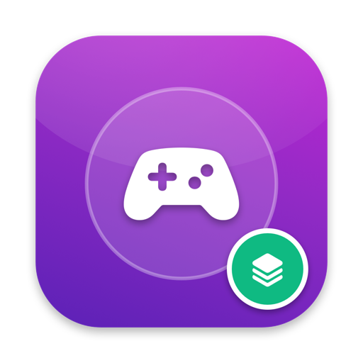
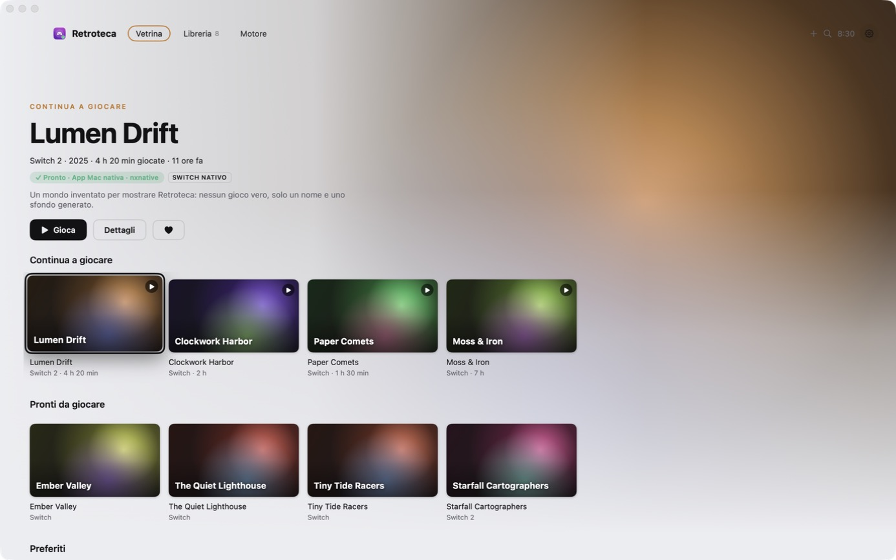

# Retroteca 🕹️


**Retroteca turns the Switch and Switch 2 games you own into native Mac apps, built on your Mac from your own dumps, and keeps them in one library.**

<p align="center"></p>

<p align="center"></p>

> **No games included.** Retroteca contains no games, firmware or keys and downloads none. You use dumps of games you own, made from your own console, and your own console's keys.

## ✨ Features

- **Your library**: drop NSP, XCI, NSZ, XCZ or NUP files (or folders) in the window. Retroteca reads the title ID, joins updates and DLC to their game and leaves every file where it is.
- **Native Mac apps**: each game is built into a Mac app on your Mac with the [nxnative](https://github.com/seedds/nxnative) engine, with every build stage shown. Builds run one at a time; a game opens from Retroteca like any app.
- **Engine updates**: Retroteca pins the engine commit it was tested with, tells you what a newer one changes for your games and warns when an update means rebuilding them.
- **Recommended settings**: per game and per Apple chip family, each one backed by the engine's own notes.
- **Game options**: settings, file mods (yours or from GameBanana), Atmosphère cheats and save backups and imports, stored where the game's app reads them.
- **Space under control**: real disk usage (APFS clones counted once), caches kept for fast rebuilds or deleted after each build, a free-space margin builds respect, and per-game cleanup.
- **External disk**: build and keep the games on an APFS disk attached to your Mac; saves stay on the Mac.
- **Store artwork**: banner, icon, description and screenshots from Nintendo's store, looked up by title ID.
- **Controllers**: move around the whole app with a game controller, with per-pad button mapping.
- **Palettes and languages**: Graphite, Day, Night blue and Auto; Italian and English.

## 🚀 Requirements

- macOS 14 or later, Apple silicon, to use the library.
- To build games: macOS 26.6 or later, Xcode 27.2 with the Metal Toolchain, Homebrew, and free disk space of about twice the game's size plus 10 GB for a first build. Retroteca installs the remaining tools through Homebrew.
- Your own game dumps and your console's `prod.keys` (Switch 2 NUP files carry what they need).

## 🍺 Installation via Homebrew

```bash
brew install --cask gionnio/tap/retroteca
```

## 📥 Manual Installation

Download the latest `Retroteca_vX.Y.Z.zip` from [Releases](https://github.com/Gionnio/retroteca/releases/latest), unzip it and move **Retroteca.app** to **Applications**.

### ⚠️ How to open the app

Retroteca is not signed with an Apple Developer ID.
1. Open the app once and close the warning.
2. Open **System Settings → Privacy & Security** and click **Open Anyway** next to Retroteca's message.
3. Confirm with **Open**.

Right-click → Open no longer works on macOS 15 or later.

## 🛠 Build from Source

```bash
git clone https://github.com/Gionnio/retroteca.git
cd retroteca
./build_app.sh --install
```

`build_app.sh` runs the tests, builds a release, assembles the app and installs it in `/Applications`. The core's tests run on their own with `cd app && swift test`.

## 🚧 Roadmap & TODO

- [x] Library from your own dumps, with updates and DLC
- [x] Native Mac apps built with nxnative, with engine updates
- [x] Game options: settings, mods, cheats, saves
- [x] Space management and external disks
- [ ] More engines as they become available
- [ ] Couch mode (full screen, controller first)

## Privacy & Security

- No accounts, no tracking. Retroteca talks to GitHub (the engine's source and updates), Homebrew, GameBanana (mods, when you open them) and Nintendo's store search (title ID only, for artwork and descriptions).
- Your console keys stay on your Mac, in a private copy readable only by you; they are never shown, logged or sent anywhere.

## ⚖️ Your games, your files

Retroteca includes no games, firmware or keys, and links to none. Use dumps of games you own, made from your own console, and your own console's keys. Whether you may copy or convert a game you own depends on where you live.

Retroteca is not affiliated with Nintendo. Nintendo Switch is a trademark of Nintendo. Builds use [nxnative](https://github.com/seedds/nxnative) by seedds (MIT); each game's app is built on your Mac and stays on your Mac.

## 🤖 AI Acknowledgment

This application was developed with the assistance of Artificial Intelligence. The code was written, reviewed and tested together with AI tools.

Created with AI, ❤️ and SwiftUI.
